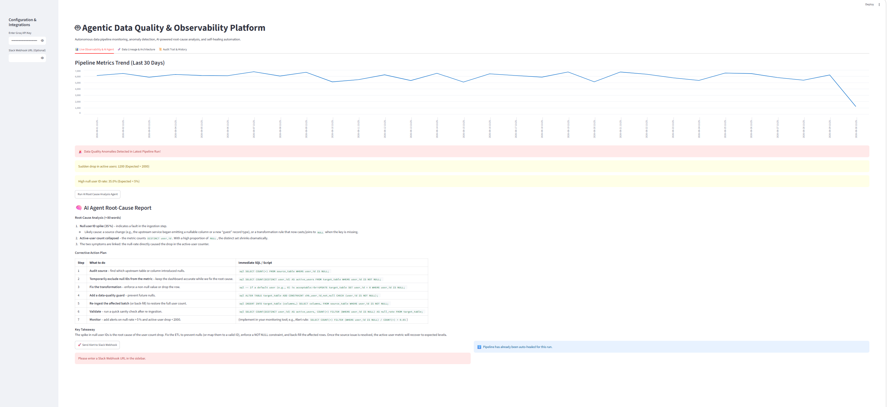

# Agentic Data Quality & Observability Platform


[Live demo](https://agentic-data-quality.streamlit.app)

A prototype that explores how an LLM can support data quality work: a Streamlit
dashboard for pipeline metrics, plus a small Python module that runs rule-based
checks first and asks an LLM to interpret the results.

> **Note on data:** all data in this project is synthetic, generated by
> `generate_data.py`. No real pipeline or warehouse is connected.



## What the dashboard does

- **Pipeline metrics tab:** plots synthetic metrics (active users, null user ID
  rate, transaction volume) from `pipeline_metrics.csv`. Data is read from CSV
  when the page loads; it is not streamed.
- **AI root-cause analysis tab:** sends a fixed demo scenario (an 18% spike in
  null `user_id` values) to a Groq-hosted model (`openai/gpt-oss-120b`) and
  displays the suggested root causes and remediation plan. The scenario text is
  hard-coded; the dashboard data is not sent to the model.
- **Auto-remediation:** simulated. The button shows a message and changes nothing.
- **Slack alert:** posts a data quality summary (score, row count, missing
  values) to a Slack incoming webhook if a URL is entered in the sidebar.
  Implemented with `requests`; not yet verified against a live Slack workspace.

## The agents module (command line)

`agents/` is separate from the dashboard and is run from the command line.

- `quality_agent.py` (`DataQualityAgent`): loads a CSV, runs rule-based checks
  (row count, missing values, min/max of `amount`, invalid `status` values), then
  sends only the **summary** of those results to a Groq model
  (`llama-3.3-70b-versatile`, temperature 0.1) and prints its analysis.
  Raw rows are not sent to the LLM.
- `multi_agents.py`: three plain Python classes (`ValidatorAgent`,
  `RemediationAgent`, `ReporterAgent`). They are rule-based and make no LLM
  calls. `RemediationAgent` returns suggested fixes as text and does not execute
  anything.

Design choice: deterministic checks run first, and the LLM only interprets their
summary. This keeps the detection reproducible and limits what is shared with an
external API.

## Run locally

```bash
git clone https://github.com/tutarzeliha-ctrl/agentic-data-quality
cd agentic-data-quality
python -m venv .venv
# Windows PowerShell: .venv\Scripts\Activate.ps1
# macOS/Linux:        source .venv/bin/activate
pip install -r requirements.txt
python generate_data.py
streamlit run app.py
```

Enter your own Groq API key in the sidebar, or set the `GROQ_API_KEY`
environment variable. The key is used in memory for the API call and is not
written to disk by this app.

To run the agent from the command line (from the repository root):

```bash
python agents/quality_agent.py
```

This reads `config/sample_transactions.csv` and requires `GROQ_API_KEY`.

## Project structure

```
app.py                   Streamlit dashboard
agents/                  Rule-based checks + LLM analysis (command line)
utils/                   Slack alert helper, data generator
connectors/, metadata/   Supporting modules
pipelines/               Prefect pipeline module (not used by the dashboard)
config/                  Sample transaction data
generate_data.py         Creates the synthetic dashboard metrics
```

## Tech stack

Python, Streamlit, Pandas, Groq API, Requests, Loguru, Prefect

## Limitations and next steps

- Synthetic data only; not tested against a real warehouse.
- The dashboard's AI analysis uses a fixed scenario, not the plotted metrics.
- The dashboard and the agent module use different models and are not connected.
- `audit_history.csv` is loaded but not yet displayed.
- LLM suggestions are not validated before use.
- Next: connect the analysis to the plotted metrics, and feed dbt test results
  (`run_results.json`) into the same workflow.